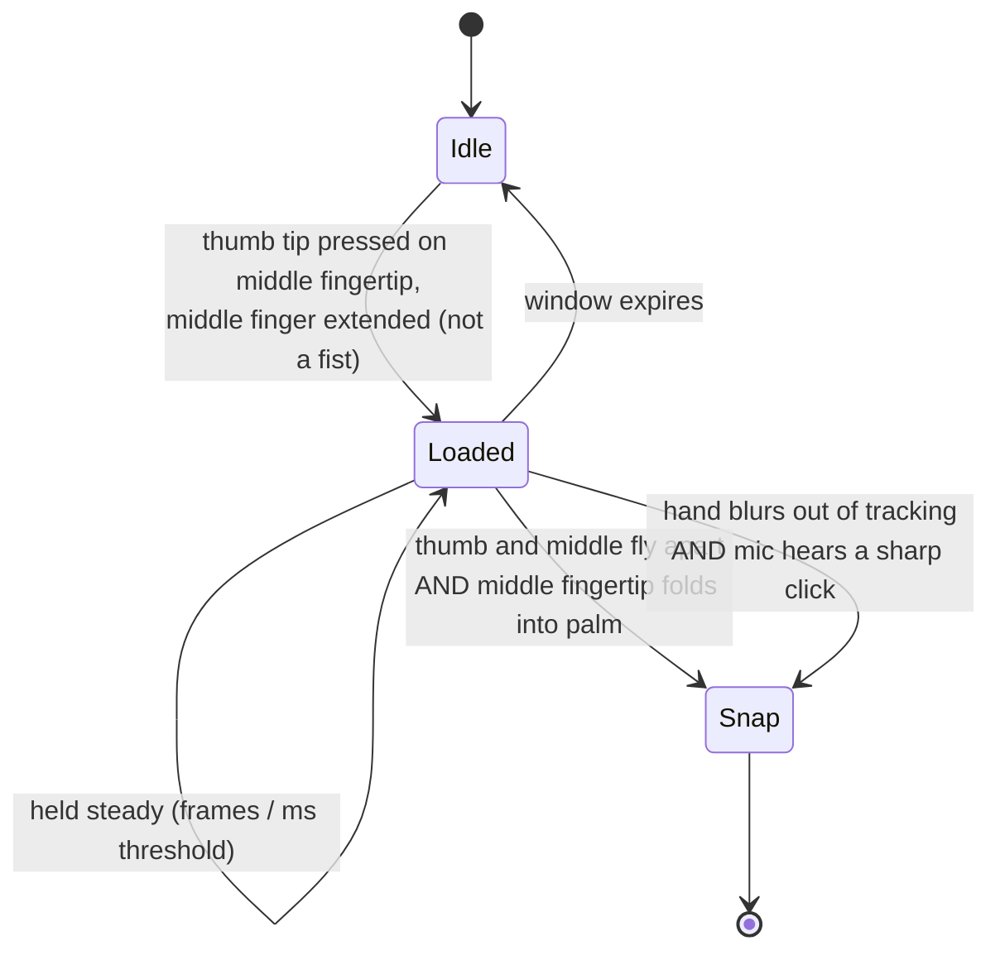

<div align="center">

```
 ____  _   _    _    ____    __     ___    _   _ ___ ____  _   _
/ ___|| \ | |  / \  |  _ \   \ \   / / \  | \ | |_ _/ ___|| | | |
\___ \|  \| | / _ \ | |_) |   \ \ / / _ \ |  \| || |\___ \| |_| |
 ___) | |\  |/ ___ \|  __/     \ V / ___ \| |\  || | ___) |  _  |
|____/|_| \_/_/   \_\_|         \_/_/   \_\_| \_|___|____/|_| |_|
```

### Snap your fingers. Turn to dust. Leave the room behind.

**A Chrome / Brave / Edge extension that puts the Avengers: Endgame snap on your webcam, live, inside Google Meet, Teams and Zoom.**

`Manifest V3` · `MediaPipe (WASM + WebGPU)` · `Insertable Streams` · `100% on-device` · `zero network calls`

</div>

---

## What it does

1. You hold up your hand and **snap your fingers** on camera.
2. Your body breaks into **tens of thousands of particles made of your own pixels**, which blow away on the wind and fade to ash.
3. Where you were, everyone in the call sees **a real photo of your empty room**, not a blur, not a green screen, not an AI guess.
4. Your mic mutes itself. Snap again and the dust flies back and **reassembles you**.

Everyone in the meeting sees it, because the effect is applied to the camera track *before* the meeting site ever receives it.

---

## Why this is harder than it looks

Most "webcam effect" extensions draw an overlay on the page, which only you can see. Snap Vanish replaces the actual camera feed the website receives, in real time, with no virtual camera driver and no desktop app. That means solving several problems at once:

| Problem | How it is solved |
|---|---|
| Get between the camera and the meeting app | Wraps `navigator.mediaDevices.getUserMedia` in the page's own JS world at `document_start`, so the site only ever sees the processed track |
| Run ML on a page whose CSP forbids it | The models run in a hidden **extension-origin iframe**, so the site's Content-Security-Policy cannot block WASM or model files |
| Make the fake track pass for a real camera | The generated track copies the real camera's `label`, `getSettings()`, `getCapabilities()` and constraints, and the hook's `toString()` reports `[native code]` |
| Never leak the raw feed while "vanished" | One frame in flight; when the engine is busy, frames are **dropped, not passed through**, so you can't flicker back into view |
| Never freeze the call if something crashes | A watchdog passes raw video only if the engine stops responding for several seconds, and retries automatically |
| Detect a finger snap, not a wave or a keyboard click | A two-phase gesture state machine on hand landmarks, optionally confirmed by the microphone (details below) |
| Look real instead of "AI-ish" | The vanished frame is a **real photograph** of the room, not generated or inpainted pixels |

---

## Architecture

```
 meeting site (Meet / Teams / Zoom web / anything)
        │  getUserMedia({ video, audio })
        ▼
 ┌──────────────────────────── page world ─────────────────────────────┐
 │ src/inject.js                                                       │
 │  • hooks getUserMedia, wraps the camera track                       │
 │  • MediaStreamTrackProcessor  ──frames──▶ ImageBitmap (transferred) │
 │  • MediaStreamTrackGenerator  ◀──frames── processed ImageBitmap     │
 │  • mic listener (snap "click"), mic mute controller                 │
 └───────────────┬───────────────────────────────▲─────────────────────┘
                 │ postMessage (transferable)    │
                 ▼                               │
 ┌───────────────────── hidden extension iframe (engine.html) ─────────┐
 │ src/engine.js                                                       │
 │  ├─ MediaPipe ImageSegmenter   → who is the person?                 │
 │  ├─ MediaPipe HandLandmarker   → 21 landmarks × 2 hands             │
 │  ├─ src/snap-detector.js       → did they snap?                     │
 │  ├─ empty-room photo           → what is behind them?               │
 │  └─ dust simulation            → how does the person disappear?     │
 └─────────────────────────────────────────────────────────────────────┘
        ▲                                         ▲
        │ settings (chrome.storage.sync)          │ room photo (chrome.storage.local)
 ┌──────┴───────────┐   ┌─────────────────┐   ┌────┴──────────────────┐
 │ src/bridge.js    │   │ src/background  │   │ popup.html / .js / .css│
 │ (isolated world) │   │ Alt+Shift+S     │   │ capture / upload / UI  │
 └──────────────────┘   └─────────────────┘   └────────────────────────┘
```

**Two content scripts, two worlds.** `inject.js` has to live in the page's `MAIN` world because that is where `getUserMedia` lives. It cannot touch `chrome.*` APIs, so `src/bridge.js` runs in the isolated world and relays settings, shortcuts and the engine URL over tagged `postMessage` channels.

---

## The snap detector

`src/snap-detector.js` is pure logic with no DOM, working on MediaPipe's 21-point hand landmarks. A real snap has two phases, and **both** must happen on the same raised hand, in the same place, within a fraction of a second:



What makes it robust:

- **Scale-invariant.** Every distance is divided by hand size (wrist to middle knuckle) and corrected for the video's aspect ratio, so it works the same near or far from the camera.
- **Rejects false positives on purpose.** Hands low in the frame, touching the bottom edge (typing, resting), tiny or far hands, low-confidence hands, a slow un-pinch, and a click sound with no matching hand pose are all ignored.
- **Motion-blur aware.** A real snap is fast enough that tracking often drops out. The detector accepts a *clearly loaded, raised hand that vanished right before a sharp click*, and nothing weaker.
- **Adapts to slow machines.** Timing windows stretch to a multiple of the measured frame interval, and one strongly loaded frame can count when frames are far apart.
- **Tunable.** One sensitivity slider (1 to 5) maps to a full set of thresholds: pinch distance, extension, hold time, release distance, fold depth, window, minimum size, confidence and maximum wrist height.

### Microphone click confirmation

Optional second sensor. The page's mic stream is cloned, run through a **2.2 kHz high-pass filter** into an `AnalyserNode`, and sampled every 15 ms. A peak counts as a snap click only if it is above an absolute level **and** more than 6× an **adaptive noise floor**, with a 250 ms refractory period. The mic can only *confirm* a snap the camera already half-saw. It can never trigger one on its own.

---

## The dust engine

Everything below runs per frame in `src/engine.js`.

- **Segmentation** runs on a 256-px-wide copy of the frame (MediaPipe selfie segmenter), giving a soft confidence mask over a coarse grid.
- **Dissolve order** per grid cell = fractal value noise (3 octaves of hash-based noise) blended 62/38 with a sweep along the wind direction, normalised over just the cells the person covers. The downwind side goes first, with ragged organic edges, like the film.
- **Particles.** Each cell the front crosses spawns particles that take **the color of your actual pixel**. Up to **60,000 particles** live in structure-of-arrays typed arrays (`Float32Array` / `Uint32Array`), with swap-removal and **no per-frame allocations**, then blit into a small canvas that is upscaled to the frame.
- **Motion.** Wind acceleration plus sinusoidal curl, drag, per-particle lifetime, and a color blend toward ash as particles age.
- **Reappearing** plays the effect backwards: particles start far upwind, fly in on eased curves with a slight sideways sway, and lock into the exact pixel they came from.
- **Blurred-arm rescue.** Fast hands get missed by the segmenter. The engine keeps a decaying "where the body has been" history and runs a **bounded breadth-first flood fill** through connected motion near the body (limited to about an arm's length and 20% of the frame, so sensor noise can never spread across the image).
- **Global change rejection.** If more than a quarter of the frame changes at once (lights, exposure, camera bump) that is not you moving, and motion is ignored for that frame.
- **Black-frame guard.** Cameras emit blank frames at startup. A luminance and variance check keeps garbage masks from ever being used.

### Auto GPU/CPU selection

On startup the engine benchmarks its own models. Both start on the **GPU delegate**; after a warm-up it measures 15 frames, and if the GPU path averages 25 ms or more it loads the **CPU (WASM/XNNPACK)** models too, times those, and **keeps whichever is faster on your machine**. Integrated GPUs that are busy encoding the meeting video are often slower than the CPU path, so this matters.

---

## The empty-room photo (no AI background)

An earlier version generated the hidden part of the room with an inpainting model. It looked fake, so it was removed entirely. Now the room behind you is **a real photograph you supply once**:

- **Capture empty room:** a 5-second countdown while you step out of view. The engine then **waits until the segmenter has seen nobody for 8 consecutive frames** (it gives up after 12 s instead of saving a photo with you in it), grabs 8 full-resolution frames, **averages them to cancel sensor noise**, and saves a JPEG.
- **Upload photo:** any image, centre-cropped to the camera's aspect ratio.
- **Seamless hand-over.** While you dissolve, the *rest* of the frame cross-fades into the photo (`stillMix`) so there is no lighting pop. Once you are fully gone, the output is **100% the photo**: no live pixels, no masks, nothing that can look patched.
- Stored in `chrome.storage.local`, hot-reloaded in every tab the moment it changes.

---

## Mic and meeting integration

When you vanish, your mic should mute too. Snap Vanish does this the polite way first:

1. **Presses the meeting app's own mic button** (Google Meet's `data-is-muted` toggle; Teams, Zoom and others by multilingual `aria-label` matching), so the app's UI and every other participant correctly see you as muted.
2. If the button can't be found, or the app ignores the click, it falls back to **disabling the page's audio tracks** (silence).
3. It only ever undoes **its own** mute. If you were already muted, it leaves your mic alone.

---

## Install (2 minutes)

> **Do not load it from OneDrive / Dropbox / iCloud folders.** Sync clients can lock or replace files with placeholders, and Chrome will fail with "Manifest file is missing or unreadable". Use a plain local folder such as `C:\snap-vanish`.

1. Copy the project to a permanent local folder (the one that directly contains `manifest.json`).
2. Open `chrome://extensions` (or `brave://extensions`) and turn on **Developer mode**.
3. Click **Load unpacked** and select that folder.
4. Pin the extension from the puzzle-piece menu.
5. Reload any meeting tab that was already open.

Requires **Chrome 111+** (or a recent Brave / Edge).

## Use it

1. Open the popup and click **Capture empty room** (or **Upload photo**). Step out of view and wait for the "saved" message. Do this once per camera position.
2. Join a call with your camera on.
3. **Snap** with your hand raised near face or chest height, palm toward the camera: press thumb and middle finger together for a moment, then snap so the middle finger hits your palm.
4. **Snap again** to come back.

Backups: **Alt+Shift+S** in the meeting tab, or **Snap now** in the popup.

### Settings

| Setting | What it does |
|---|---|
| On / off | Disables the effect instantly; the camera goes back to normal |
| Detect finger snaps | Turns hand-tracking detection on or off |
| Use mic to confirm snap click | Adds the high-pass click detector |
| Mute my mic while vanished | Mutes on vanish, unmutes on return |
| Snap sensitivity (1 to 5) | Raise if snaps are missed, lower if it fires by accident |
| Dust duration | How long the disintegration takes |
| Dust blows | Wind direction: right, left or up |
| Debug overlay | Draws the hand skeleton, detector values and fps **into your video** (testing only, others will see it) |

### Debug overlay

Shows the effect state, fps, ms per frame, GPU/CPU choice, particle count, per-hand thumb-middle and middle-wrist ratios, `LOADED` and `ARMED: snap now` flags, why the last snap fired (`vision`, `vision+click`, `blur+click`), and whether the room photo is loaded. Under about 40 ms per frame is smooth.

---

## Project layout

```
manifest.json            MV3 manifest
engine.html              hidden engine page (loaded in an iframe)
popup.html/.css/.js      toolbar popup: toggles, capture, upload
icons/                   16 / 48 / 128 px
src/
  inject.js              page-world getUserMedia hook, frame pump, mic mute
  bridge.js              isolated-world relay (settings, triggers, status)
  engine.js              segmentation, room photo, capture, dust simulation
  snap-detector.js       two-phase finger-snap state machine
  defaults.js            default settings
  background.js          Alt+Shift+S command handler
lib/                     MediaPipe Tasks Vision (Apache-2.0) + WASM
models/                  hand_landmarker.task, selfie_segmenter_landscape.tflite
test/                    local camera test page
```

---

## Privacy

- **Nothing leaves your machine.** No servers, no analytics, no remote models, no network requests. Models and WASM load from inside the extension package.
- The only permission requested is `storage` (settings and your room photo). Camera access is the one the meeting site already asked you for; the extension hooks that same stream.
- Your video goes out only through the meeting itself, exactly as before.

## Limitations

- **Browser only.** Works in Chromium browsers and in the *web* versions of Meet, Teams and Zoom. Desktop apps open the camera directly, so an extension can't reach them.
- **Keep the camera still.** The room photo only matches while the camera is in the same spot with similar lighting. Re-capture after moving it.
- When vanished, **other people in the room are hidden too**, because the output is the still photo.
- The mic-button logic is tuned for Meet's current layout; elsewhere it falls back to silencing the audio track.
- Hand tracking works best with a well-lit hand at roughly face size or larger.

## Local testing

```
python -m http.server 8000 --directory test
```

Open `http://localhost:8000`, click **Start camera**, then snap. (Served over http because extensions don't run on `file://` pages by default.) Google Meet's instant-meeting preview also shows exactly what others would see.

---

## Inspiration and credits

Inspired by the snap scene from **Avengers: Endgame**. This is an independent fan project and is **not affiliated with or endorsed by Marvel or Disney**.

Built with [MediaPipe Tasks Vision](https://ai.google.dev/edge/mediapipe) (Apache-2.0) for hand landmarks and person segmentation.
